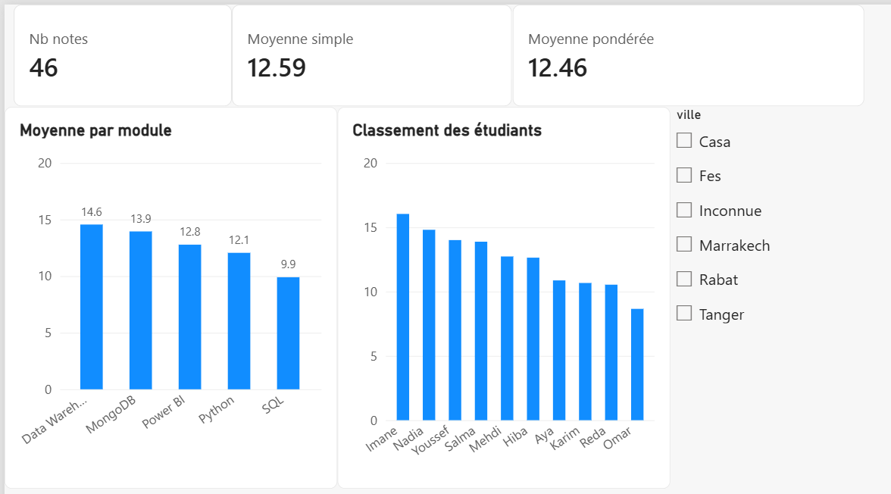
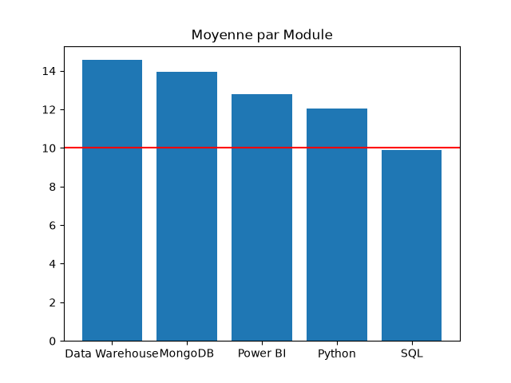

# 🎓 Analyse des notes d'une école — Pipeline Python, MongoDB & Power BI

Projet de bout en bout : des fichiers CSV « sales » jusqu'à un dashboard Power BI interactif, en passant par le nettoyage en Python, le stockage dans MongoDB et l'analyse par agrégation.

## 🎯 Objectif

Analyser les résultats des étudiants d'une école :
- la moyenne de chaque module ;
- le classement des étudiants selon une **moyenne pondérée par les coefficients** ;
- la comparaison des résultats par ville.

## 🛠️ Technologies

- **Python** : pandas, pymongo, matplotlib
- **MongoDB** (dans Docker) : stockage NoSQL et pipelines d'agrégation
- **Power BI** : modèle en étoile, mesures DAX, dashboard interactif
- **Git / GitHub**

## 🔄 Pipeline

```
CSV bruts → 1. Diagnostic → 2. Nettoyage → 3. Chargement MongoDB → 4. Analyse → Dashboard Power BI
```

| Étape | Script | Rôle |
|---|---|---|
| 1 | `1_diagnostic.py` | Repérer les problèmes : valeurs manquantes, doublons, notes hors limites, villes mal écrites |
| 2 | `2_nettoyage.py` | Nettoyer : suppression des doublons, villes normalisées (`strip`, `title`), villes manquantes → `Inconnue`, notes converties en nombres et filtrées entre 0 et 20 |
| 3 | `3_load_mongo.py` | Charger les 3 tables nettoyées dans la base MongoDB `ecole` (avec gestion d'erreur si le serveur ne répond pas) |
| 4 | `4_analyse.py` | Pipeline d'agrégation MongoDB (`$group`, `$lookup`, `$unwind`, `$project`, `$sort`) + graphique matplotlib |
| 5 | `dashboard_ecole.pbix` | Dashboard Power BI |

## 📁 Données

| Table | Contenu | Lignes après nettoyage |
|---|---|---|
| `etudiants` | id, nom, prénom, ville | 10 |
| `modules` | id, module, filière, coefficient | 5 |
| `notes` | id étudiant, id module, note | 46 |

## 📊 Dashboard Power BI



- **Modèle en étoile** : `notes` (table de faits) reliée à `etudiants` et `modules` (dimensions)
- **Mesures DAX** :
  - `Nb notes = COUNTROWS(notes_clean)`
  - `Moyenne simple = DIVIDE(SUM(notes_clean[note]), [Nb notes])`
  - `Moyenne pondérée = DIVIDE([Total pondere], SUMX(notes_clean, RELATED(modules[coef])))`
- **Filtre par ville** : tous les visuels se mettent à jour automatiquement

## 📈 Résultats clés

- Moyenne générale pondérée : **12,46 / 20**
- Meilleur module : **Data Warehouse (14,56)** ; module le plus faible : **SQL (9,90)**, seul module sous la moyenne
- Top 3 des étudiants : **Imane (16,03)**, **Nadia (14,80)**, **Youssef (14,00)**



## ▶️ Lancer le projet

```bash
# 1. Démarrer MongoDB (Docker)
docker run -d --name mongo -p 27017:27017 mongo:7

# 2. Créer l'environnement Python
python -m venv .venv
.venv\Scripts\Activate.ps1        # Windows
pip install -r requirements.txt

# 3. Exécuter le pipeline
python 1_diagnostic.py
python 2_nettoyage.py
python 3_load_mongo.py
python 4_analyse.py
```

Ouvrir ensuite `dashboard_ecole.pbix` avec Power BI Desktop.

## 👤 Auteur

**Ilyas** — Étudiant en Business Intelligence (CI3), ISMAGI Rabat
